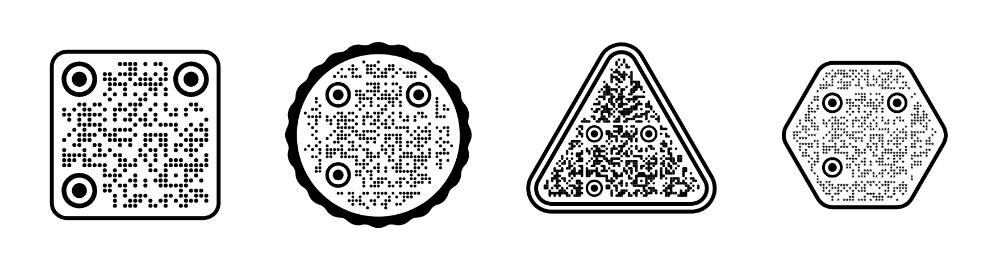

# qr-code-shapes

QR codes that are not square. Circles, triangles and hexagons, drawn as SVG,
with no dependencies and no canvas.



**[Make a QR code on koloqr.com →](https://koloqr.com)**  ·  [live demo of this library](https://koloqr.github.io/qr-code-shapes/demo/)

Most QR libraries give you a grid of black squares and a colour option. This one
draws the code into an outline — a disc, a triangle, a hexagon — culling the
modules that fall outside and filling the edge so the shape reads cleanly. The
codes still scan; error correction is fixed at level H, which is what buys the
room to cut the corners off.

These are the renderers behind [koloqr.com](https://koloqr.com), pulled out into
a library. If you just want a code rather than a dependency, the site is free
and needs no signup — and it has the logos, the other 44 frames and the PDF and
EPS export that [did not belong here](#what-this-does-not-include).

## Install

```sh
npm install qr-code-shapes
```

Or use it straight from source — it is plain ES modules, no build step.

## Usage

```js
import { renderQR } from 'qr-code-shapes';

const svg = renderQR({ text: 'https://example.com' });
// → '<svg xmlns="..." viewBox="0 0 380 380">…</svg>'
```

`renderQR` returns a standalone SVG document as a string. Write it to a file,
inline it, hand it to a template — it has no runtime dependencies, so it works
the same in Node, in a worker, or during server rendering.

```js
const svg = renderQR({
  text: 'https://example.com',
  shape: 'circle',
  frame: 'organic',
  pattern: 'dots',
  color: '#1d4ed8',
  background: '#eff6ff',
});
```

### In a page

```js
import { renderQR } from 'qr-code-shapes';
import { toSVGBlob, toPNGBlob, download } from 'qr-code-shapes/browser';

const svg = renderQR({ text: 'https://example.com', shape: 'hexagon' });
document.querySelector('#preview').innerHTML = svg;

download(toSVGBlob(svg), 'qr-code.svg');
download(await toPNGBlob(svg, { size: 1024 }), 'qr-code.png');
```

The `browser` entry point is separate because rasterizing needs a canvas. The
main entry never touches the DOM.

### Editing the output

`renderQRNode` returns the SVG as a small node tree instead of a string, if you
want to reach in before serializing:

```js
import { renderQRNode, serialize } from 'qr-code-shapes';

const node = renderQRNode({ text: 'https://example.com' });
node.setAttribute('role', 'img');
node.setAttribute('aria-label', 'Link to example.com');
const svg = serialize(node);
```

## Options

| Option | Type | Default | Notes |
| --- | --- | --- | --- |
| `text` | string | — | Required. What the code encodes. |
| `shape` | string | `'square'` | `square`, `circle`, `triangle`, `hexagon` |
| `frame` | string | `'none'` | `none`, `thin`, `double`, `organic` |
| `pattern` | string | `'dots'` | Module shape — see below |
| `eyeShape` | string | `'circle'` | `circle`, `rounded`, `square` |
| `color` | string | `'#000000'` | Module colour |
| `background` | string | `'#ffffff'` | Any CSS colour, or `'transparent'` |
| `eyeColor` | string | `color` | Finder eyes, if you want them to differ |
| `frameColor` | string | `color` | Frame, if you want it to differ |
| `seed` | number | `0` | Seeds the scatter in the `star` pattern |
| `mask` | number | auto | Force a QR mask, 0–7. Changes how the code looks without changing what it says. |

Patterns: `dots`, `square`, `small`, `star`, `rounded`, `stars`, `hearts`,
`triangles`, `diamonds`, `pill-h`, `pill-v`, `bar-h`, `bar-v`. The `rounded`,
`pill-*` and `bar-*` patterns merge neighbouring modules into one shape rather
than drawing each on its own.

Every frame works with every shape — the artwork follows the outline.

The lists are exported, so a UI can enumerate them instead of hard-coding:

```js
import { SHAPES, PATTERNS, EYE_SHAPES, FRAMES } from 'qr-code-shapes';
```

Bad values throw rather than silently falling back, so a typo in `shape` shows
up immediately instead of quietly rendering a square.

## Will they scan?

Yes. Every shape, frame and pattern combination in this repo is decoded during
development with the platform barcode reader, and the tests fail if a code
stops producing well-formed output.

Two things are worth knowing. Cutting a QR into a circle or triangle throws away
real modules — level H error correction absorbs it, but it is why the error
correction level is not configurable here. And contrast is yours to get right:
a pale code on a pale background will render happily and scan badly. Keep the
code clearly darker than the background, and test the actual printed size.

## Running the demo

```sh
git clone https://github.com/koloqr/qr-code-shapes.git
cd qr-code-shapes
npm run demo    # → http://localhost:8000/demo/
```

There is nothing to install. The demo imports the library directly from `src/`,
which is also why it needs a server rather than opening the file — browsers do
not load ES modules over `file://`.

```sh
npm test
```

## What this does not include

This library is deliberately the core. [koloqr.com](https://koloqr.com) is the
full generator, and it has the parts that did not belong in a rendering library:

- 56 frames instead of 12, including ones with `SCAN ME` text set on a curve
- Logos in the centre — brand marks or your own image
- Content types beyond a link: email, phone, Wi-Fi, plain text, social profiles
- PDF, EPS and copy-to-Figma export
- A live contrast check that tells you when a colour pair will not scan

All of it free and without a signup, if you just need a code rather than a
dependency.

## Credits

The QR encoding in `src/encoder.js` is Kazuhiko Arase's
[QRCode.js](https://github.com/davidshimjs/qrcodejs), MIT licensed, cut down to
matrix generation. The drawing is original work from
[koloqr.com](https://koloqr.com).

## License

MIT
